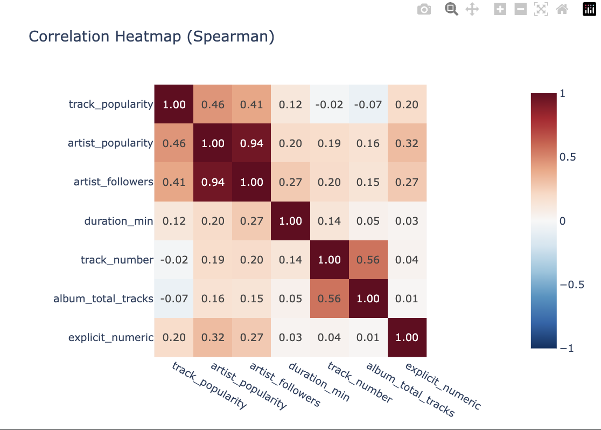
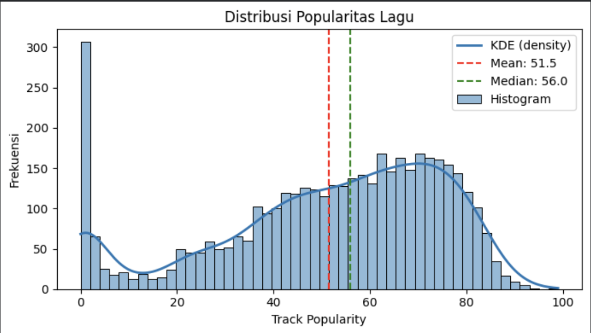
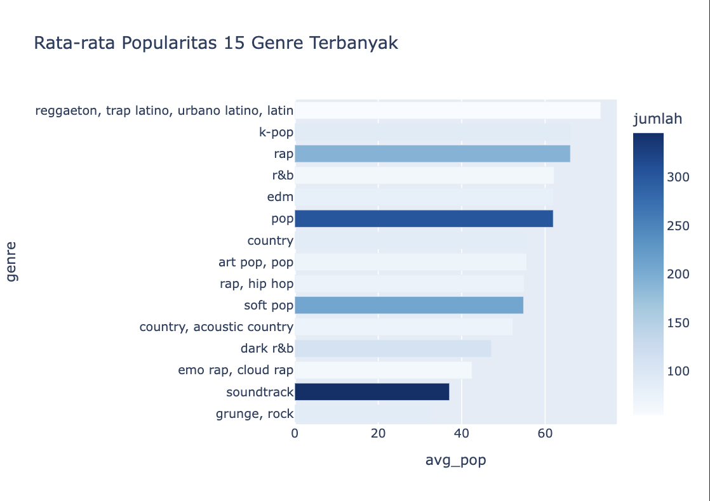
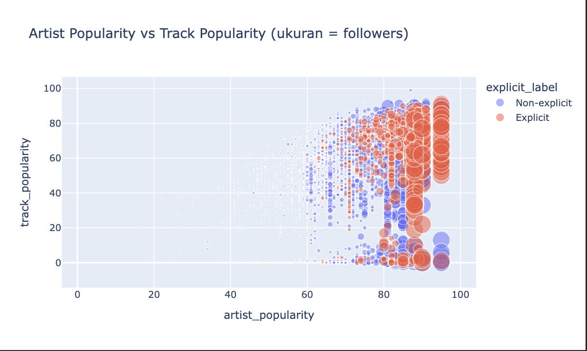
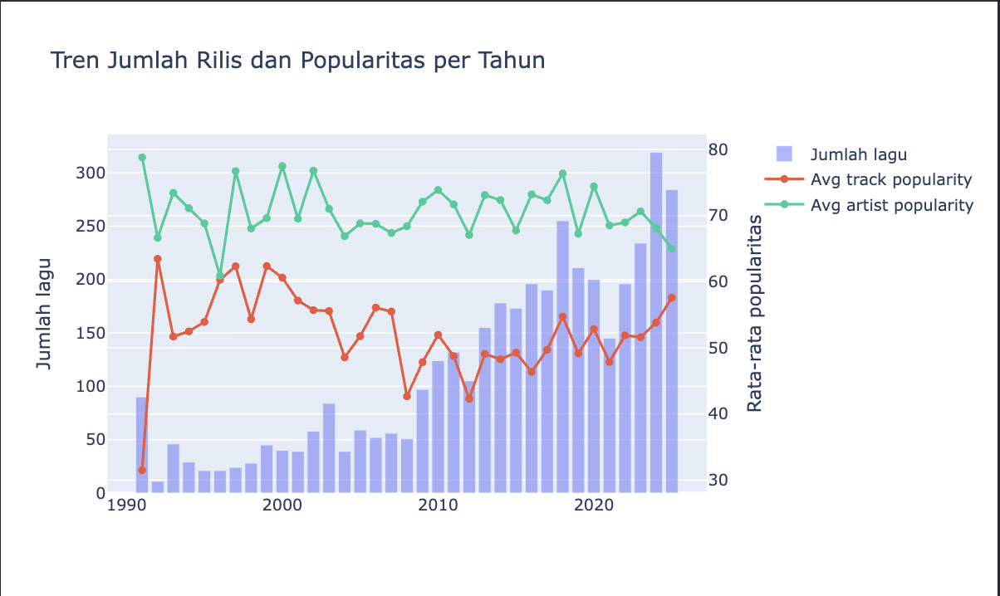

# Spotify Track Popularity Analysis

Data cleaning and visualization of Spotify tracks using Python in Google Colab.

## Project Overview

This project explores a Spotify dataset with 8,700+ tracks. Each row has information about the track, the artist, and the album. The goal is to find out what is related to a track's popularity, using simple charts.

## Problem

Why are some songs more popular than others? Is it the artist, the genre, the song length, or something else? This project looks for patterns that can help answer these questions.

## Dataset

- **Source:** https://www.kaggle.com/code/marawanmohsen1/spotify?select=track_data_final.csv
- **Size:** 8,700+ tracks
- **Main columns:** `track_name`, `track_popularity`, `track_duration_ms`, `explicit`, `artist_name`, `artist_popularity`, `artist_followers`, `artist_genres`, `album_release_date`, `album_total_tracks`

> Note: `track_popularity` is a score from 0 to 100 made by Spotify. It is not the exact number of streams.

## Tools

- Python
- Pandas
- Plotly
- Seaborn and Matplotlib
- Google Colab

## Analysis

## 1. Which variables are most related to track popularity, and are they related to each other?



Meskipun korelasi  popularitas artis sangat erat kaitannya dengan jumlah *followers*-nya (0.94), popularitas sebuah lagu ternyata sama sekali tidak ditentukan oleh durasi, posisi urutan lagu, maupun ukuran album, di mana nama besar artis (0.46) serta konten eksplisit (0.20) hanya memberikan dorongan moderat tanpa menjamin seluruh karya mereka otomatis menjadi hits.

## 2. How is track popularity spread across the dataset? Are most tracks low, medium, or high?



[Write your finding here]

## 3. Which genre has the highest average popularity, and is the biggest genre also the most popular?



[Write your finding here]

## 4. Do popular artists always make popular tracks, and do artists with many followers show a different pattern?



[Write your finding here]

## 5. How do the number of releases and average popularity change over the years?



[Write your finding here]

## Conclusion

- [Key point 1]
- [Key point 2]
- [Key point 3]

## How to Run

1. Open the notebook in Google Colab.
2. Upload the dataset file to Colab.
3. Run the cells from top to bottom.

## Files

```
├── spotify_analysis.ipynb   # full steps: cleaning and visualization
├── images/                  # chart screenshots
└── README.md
```
